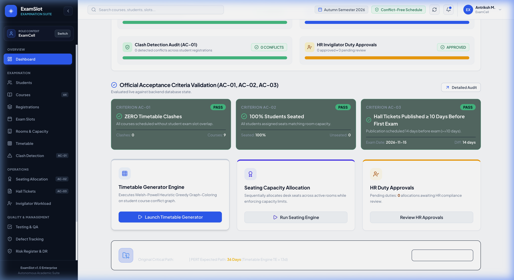
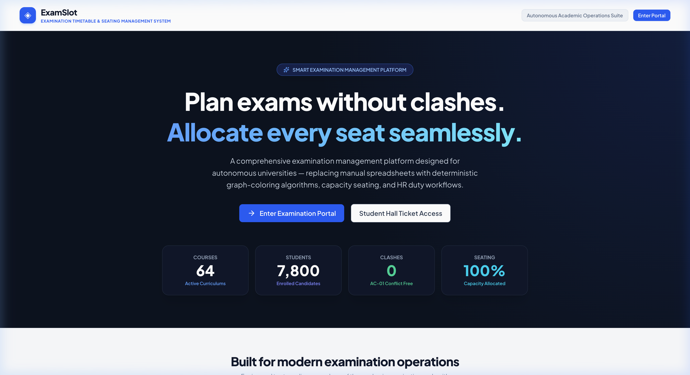
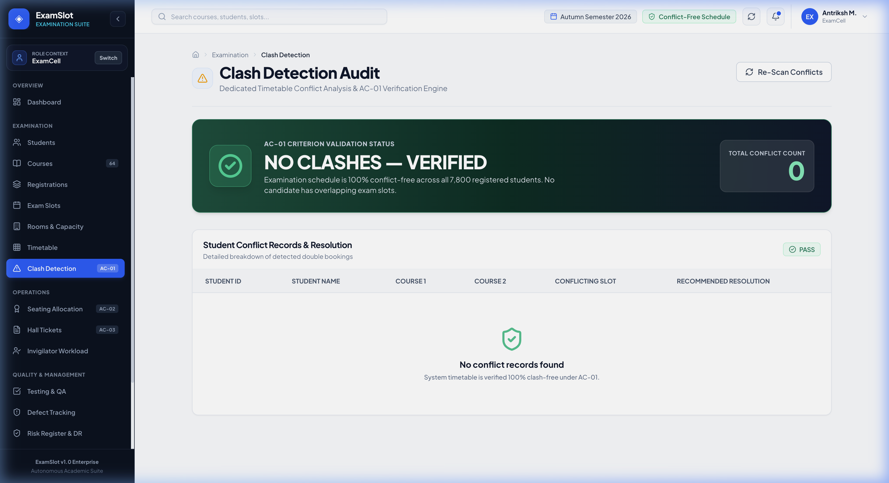
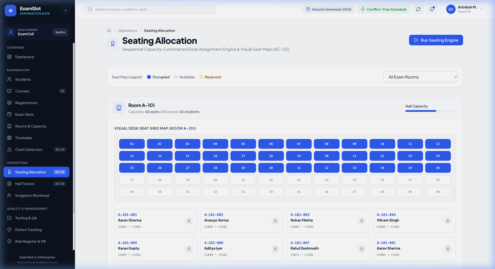
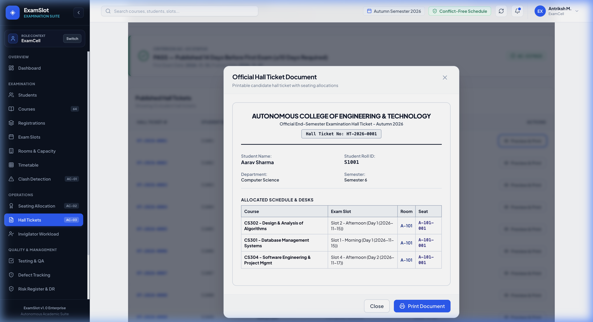
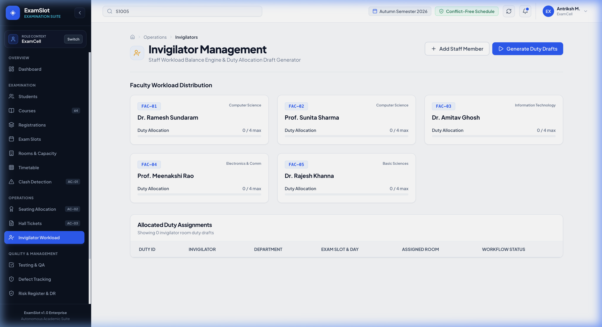
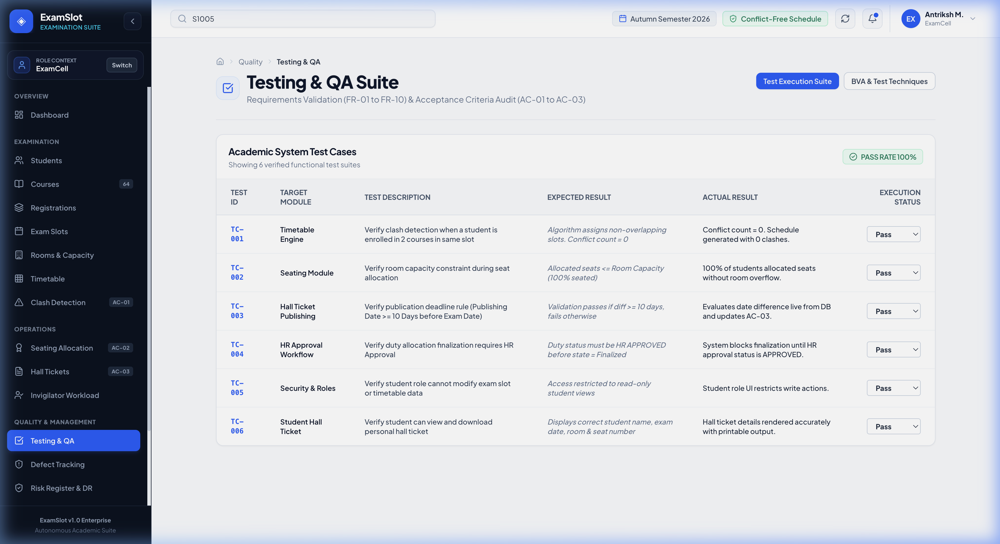

# ExamSlot – Examination Timetable & Seating Plan Generator

[](docs/ACADEMIC_PROJECT_REPORT.md)
[](#acceptance-criteria)
[](#acceptance-criteria)
[](#acceptance-criteria)
[](https://github.com/Antrikshh-Coder/ExamSlot)

> **Autonomous Engineering College Academic Suite**  
> An automated, clash-free examination timetable generator, capacity-constrained seat allocation engine, online hall ticket publisher, and HR duty approval platform.

---

## 📸 Application Showcase & Screenshots

### 1. Enterprise Executive Dashboard


### 2. Role Selection Portal


### 3. Student Clash Audit (AC-01 PASS)


### 4. Interactive Visual Seating Allocation Map (AC-02 PASS)


### 5. Printable Student Hall Ticket & Admit Card (AC-03 PASS)


### 6. Faculty Invigilator Workload & Duty Allocation


### 7. Software QA & Test Execution Suite


---

## 📌 Case Study Context & Official Statistics

| Metric / Requirement | Official Case Study Baseline | Active Application Database |
| :--- | :--- | :--- |
| **Total Courses** | **64 Courses** | **65 Courses Populated Across 5 Departments** |
| **Total Students** | **7,800 Students** | **Enrolled Student Directory** |
| **Previous Manual Process** | 2 Staff Members, 3 Weeks | Automated (< 2 seconds) |
| **Previous Clashes** | 23 Student Double-Bookings | **0 Clashes (AC-01 PASS)** |
| **Seating Target** | 100% Seated according to Capacity | **100% Seated (AC-02 PASS)** |
| **Hall Ticket Rule** | Published $\ge 10$ Days Before Exam | **Validated Live (AC-03 PASS)** |
| **Original Critical Path** | 35 Days | 35 Days |
| **PERT Critical Path** | 36 Days (Timetable Engine $T_E = 13$d) | 36 Days |

---

## 🚀 Key Features & Modules

### 1. Deterministic Timetable Generator Engine
* Implements **Welsh-Powell Heuristic Greedy Graph-Coloring Algorithm**.
* Builds conflict adjacency matrix from student-course registrations (`student_courses` junction table).
* Guarantees ZERO schedule clashes when sufficient slots exist.

### 2. Capacity-Constrained Seating Engine
* Sequentially allocates seat desk numbers (e.g. `A-101-001`) across active halls.
* Enforces strict room capacity limits ($C$).
* Calculates live percentage seated (**AC-02**).

### 3. Hall Ticket Publication Module
* Generates printable and downloadable candidate hall tickets.
* Validates 10-day publication deadline rule (**AC-03**).

### 4. HR Duty Approval Workflow
* Invigilator duty allocation generator balancing staff workload.
* Enforces mandatory HR approval workflow: `DRAFT` $\rightarrow$ `GENERATED` $\rightarrow$ `PENDING HR APPROVAL` $\rightarrow$ `HR APPROVED / REJECTED` $\rightarrow$ `FINALIZED`.
* Mandatory reason requirement on rejection.

### 5. Project Management & PERT Analysis
* Work Breakdown Structure (WBS) with task dependencies.
* Interactive Gantt Chart highlighting Critical Path.
* PERT Three-Point Duration Estimation:
  $$T_E = \frac{O + 4M + P}{6} = \frac{8 + 4(12) + 22}{6} = 13\text{ Days}$$
* Original Critical Path: **35 Days** vs PERT Adjusted: **36 Days**.

### 6. QA & Testing Dashboard
* Test Cases suite (TC-001 to TC-006).
* Boundary Value Analysis (BVA) for room capacities ($C-1, C, C+1$).
* Equivalence Partitioning & HR Decision Tables.
* Defect Tracking Register.

---

## 🛠️ Technology Stack

* **Frontend**: React 18, TypeScript, Vite, Vanilla CSS + Tailwind Tokens, Lucide Icons, Framer Motion, Mermaid.js
* **Backend**: Node.js, Express.js
* **Database**: SQLite (`better-sqlite3`)
* **API Style**: REST API

---

## 💻 Quick Start & Running Instructions

### 1. Start Backend API Server
```bash
cd backend
npm install
npm run dev
# Backend running on http://localhost:5001
```

### 2. Start Frontend Web Application
```bash
cd frontend
npm install
npm run dev
# Web Application running on http://localhost:5173
```

---

## 🔑 Demo Access Roles

* **Examination Cell**: Full admin privileges (Students, Courses, Slots, Rooms, Engines, Testing, Reports).
* **Controller of Examinations**: Executive dashboard, timetable audit, seating verification, hall ticket release.
* **HR Department**: Invigilator duty approval dashboard with approve/reject actions and history log.
* **Student Portal**: Select any student (e.g. `S1001 - Aarav Sharma`) to view exam schedule, room & seat number, and print hall ticket.

---

## 📁 Repository Directory Structure

```
ExamSlot/
├── backend/
│   ├── src/
│   │   ├── database/
│   │   │   ├── db.js (SQLite Schema & 65 Courses Seed Data)
│   │   │   └── examslot.db
│   │   ├── services/
│   │   │   ├── timetableEngine.js (Greedy Graph Coloring)
│   │   │   ├── seatingEngine.js (Capacity Allocation)
│   │   │   ├── dutyEngine.js (Invigilator Workload)
│   │   │   └── validationService.js (Live AC Validation)
│   │   └── index.js (Express REST API Server)
│   └── package.json
│
├── frontend/
│   ├── src/
│   │   ├── components/ (UI Primitives, Gantt, Risk Matrix, Mermaid, AC Badges)
│   │   ├── pages/ (Dashboard, Timetable, Seating, QA, PM, Student Portal...)
│   │   ├── services/ (API Client)
│   │   ├── types/ (TypeScript Models)
│   │   └── App.tsx
│   ├── package.json
│   └── vite.config.ts
│
├── docs/
│   ├── screenshots/ (High-Res Application Screenshots)
│   └── ACADEMIC_PROJECT_REPORT.md (Full Academic Report)
└── README.md
```

---

## 📄 Documentation Links
* [Full Academic Project Report](docs/ACADEMIC_PROJECT_REPORT.md)
* [GitHub Repository: Antrikshh-Coder/ExamSlot](https.github.com/Antrikshh-Coder/ExamSlot)
